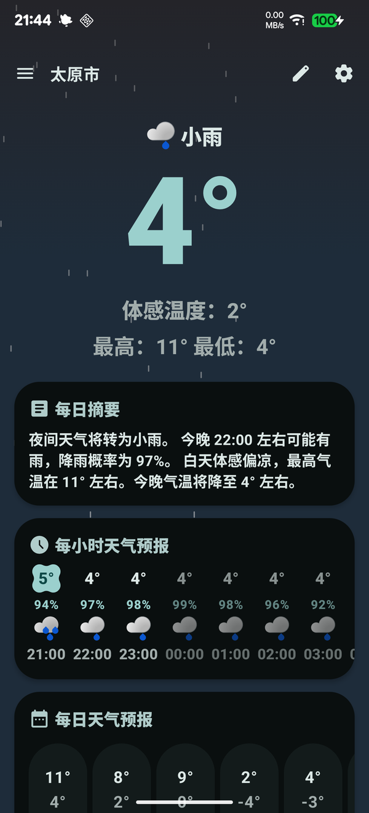

# WeatherMaster 中国大陆网络优化版

这个项目是基于 [PranshulGG/WeatherMaster](https://github.com/PranshulGG/WeatherMaster) 的**二次分发**（基于 v3.11.0，上游 commit `11828aad`），只针对一件事做了修改：

**在大陆地区，不挂代理 / VPN 也能正常刷新天气。**

> 直接下载：**[Releases · 最新版 APK](https://github.com/sangsheng2026/WeatherMaster-CN/releases/latest)**

<div align="center">
  
</div>

原版本身很好用，问题出在一个跟天气完全无关的小环节上，下面说清楚。

---

## 更新记录

### 3.11.0-cn3

- **不再检查新版本**：去掉了启动时的更新检查，不会再弹「有新版本可用」。这个分发版不催人更新，爱用哪个版本用哪个；顺带也少了一个对 `api.github.com` 的请求；
- **手动刷新不再限频**：原来缓存不到 15 分钟时下拉刷新会提示「请在 15 分钟后再刷新」，现在刷新就是真的去拉新数据。

### 3.11.0-cn2

第一版发布后的第一次更新，都是能直接感觉到的调整：

- **数据源默认走国内**：位置判定在中国境内时，天气数据源默认自动选「中国天气网」，不用再手动改（Open-Meteo 在大陆经常连接超时）；
- **设置里的「支持」换成「项目仓库」**：点一下直达本仓库，看源码、下新版、提 issue 都在那儿；
- **「后台更新」页精简**：去掉自动刷新开关和更新间隔，只留电池优化、后台任务信息、Gadgetbridge 这些排障工具；
- **移除了「加入 Discord 社区」入口**；
- **服务条款、隐私政策、更新日志改成中文**，并按这个分发版的实际情况重写（不再出现原作者邮箱）；
- **外观默认值**：跟随系统主题、动态配色开启、小青蛙布局关闭、平板布局开启、24 小时制；
- 顺手把设置里几处漏翻的英文（Worker information、Tablet layout、Alert notifications 等）翻成中文。

数据源、天气接口、界面功能都没有删改。

---

## 到底卡在哪

打开首页的时候，App 的流程是这样的：

1. 先问手机「你现在在哪」（本地定位，不联网）；
2. 再判断「你比上次记录的位置移动超过 1 公里了吗」；
3. **如果移动了，就去问一个网站「我这个坐标是哪个城市」**；
4. 问完之后，才去请求天气。

第 3 步用的是 `nominatim.openstreetmap.org`（OpenStreetMap 的地名服务）。这个域名在国内是被墙的：DNS 会被污染成一些乱七八糟的 IP，TCP 连过去也没有任何回应。

而原版给这个请求设的超时是 **30 秒**。

所以实际效果就是：**天气请求要排在这个注定失败的请求后面，干等 30 秒。**

我在自己手机（一加 12 / Android 16 / 不挂代理）上抓的日志时间线：

```
18:31:10  App 进程启动
18:31:11  向 nominatim 发请求，一直卡在 SYN-SENT（没有任何回应）
18:31:41  30 秒超时，放弃
18:31:43  天气数据才写进数据库
```

也就是说：**天气本身 1 秒就回来了，但你得为它等 32 秒。**

同一时刻我用手机直接测了几个域名：

| 域名 | 结果 |
|---|---|
| `api.open-meteo.com`（天气） | 200 / 1.79 s |
| `air-quality-api.open-meteo.com`（空气质量） | 200 / 1.22 s |
| `geocoding-api.open-meteo.com`（城市搜索） | 200 / 3.20 s |
| `secure.geonames.org` | 200 / 0.82 s |
| **`nominatim.openstreetmap.org`** | **不通** |

所以不是天气服务器的问题，是地名查询把天气堵住了。一开代理它通了，一切就顺了——这就是「挂代理就好了」的真正原因。

还有一个连带问题：**首页标题一直是一串坐标**（比如 `37.81195, 112.59257`），从来不显示城市名。原因是两层的：地名查询在国内根本不会成功；而且就算成功，原版把名字写进数据库之后，也没有同步刷新首页用的那份位置快照。

---

## 我改了什么

### 1. 把「问地名」从关键路径上拿下来

原版是「问完地名 → 才请求天气」，我改成：

- 先把坐标存下来（本地操作，不联网）；
- 地名查询丢到**后台协程**里慢慢搞，**最多等 5 秒**；
- 天气该请求就请求，完全不等地名。

涉及 `WeatherContextRepository.kt`；首次启动那条路径（`IntroScreenViewModel.kt`）也一并加了时限。

### 2. 中国大陆的城市名改成离线解析

既然联网查地名在国内大概率不通，那就干脆不联网：

- 内置一份**中国行政区划中心点数据**（省 + 地级市/区，共 509 个点，31.8 KB）；
- 拿到坐标后，在本地找最近的中心点，100 公里以内就用它的名字；
- **市级优先于省级**（不然会显示「山西省」而不是「太原市」——这是我第一版踩的坑）；
- 判断是不是在中国境内，用的是项目里本来就有的 `china.geo.json`。

数据是从阿里云 DataV 的公开行政区划边界里提取的，生成脚本在 `tools/build_cn_places.py`，可以自己重新跑一遍。

这步完全不联网、不上传坐标，也没有引入任何第三方库。

### 3. 修掉「地名更新了，首页不刷新」

`LocationManager.kt` 里，位置数据更新后只更新了位置列表，没更新首页正在用的 `activeLocation` 快照。现在会同步。

### 4. 刷新转圈只跟天气走

`WeatherManager.kt`：原来要等天气 + 空气质量 + 预警**全部**结束才停转圈，现在天气一到就停。

---

## 实测效果

（一加 12 / Android 16 / 中国大陆 / 不挂代理 / Open-Meteo 数据源）

|  | 原版 | 这个版本 |
|---|---|---|
| 首次添加位置 → 首页出天气 | 32 秒 | **4 秒** |
| 冷启动 → 首页出现 | 受 30 秒阻塞影响 | **2 秒** |
| 首页标题 | `37.81195, 112.59257` | **太原市** |
| 刷新转圈 | 等天气 + 空气质量 + 预警 | 天气返回即结束 |

天气数据源、空气质量源、预警源一个都没换；其他国家和地区的行为也没动（离线地名只在中国境内生效）。

---

## 下载

### 👉 [点这里下载 APK](https://github.com/sangsheng2026/WeatherMaster-CN/releases/latest)

最新版文件名是 `WeatherMaster-CN-<版本号>.apk`。

- 包名是 `com.pranshulgg.weather_master_app`，**和 Play 商店版不冲突**，可以两个都装；
- 需要 Android 8.0（API 26）以上。

## 自己编译

需要：JDK 17+（我用的 21/25 都可以）、Android SDK（compileSdk 37）、Gradle 9.7（wrapper 里配好了）。

1. `cp gradle.properties.sample gradle.properties`，按需填 API key（不填也能用 Open-Meteo 这类免费源）；
2. `./gradlew assembleRelease`（Windows 用 `gradlew.bat`）；
3. 产物在 `app/build/outputs/apk/release/`。

> 小提示：项目路径别放在含中文的目录下，AGP 会直接拒绝构建（`android.overridePathCheck=true` 能绕过，但中间产物路径可能还会出问题）。

## 已知限制

- 地名精确到地级市/区，不是街道级；离最近城市中心超过 100 公里时退回显示坐标；
- 地名固定中文，不随界面语言变化；
- 台湾省的分级数据源当时返回 404，那片区域会退回省级名或坐标；
- 如果你挂着代理，后台联网查地名仍然会跑（成功就覆盖离线名），这部分行为跟原版一致。

## 致谢与许可

- 上游：[PranshulGG/WeatherMaster](https://github.com/PranshulGG/WeatherMaster)，作者 Pranshul GG 以及所有贡献者；
- 项目遵循 **GPL-3.0**，这个修改版**同样遵循 GPL-3.0**，源码就是本仓库，欢迎自己编译、也欢迎提 PR 合回上游；
- 行政区划数据来源：阿里云 DataV.GeoAtlas（`geo.datav.aliyun.com`）；
- 我只是针对大陆网络环境做了一点点适配，App 本身的功能、界面、数据源全是上游的功劳。

## 修改清单

完整的改动说明（含实测数据、逐个文件清单、给上游的同步建议）见 [CHANGES-CN.md](CHANGES-CN.md)。